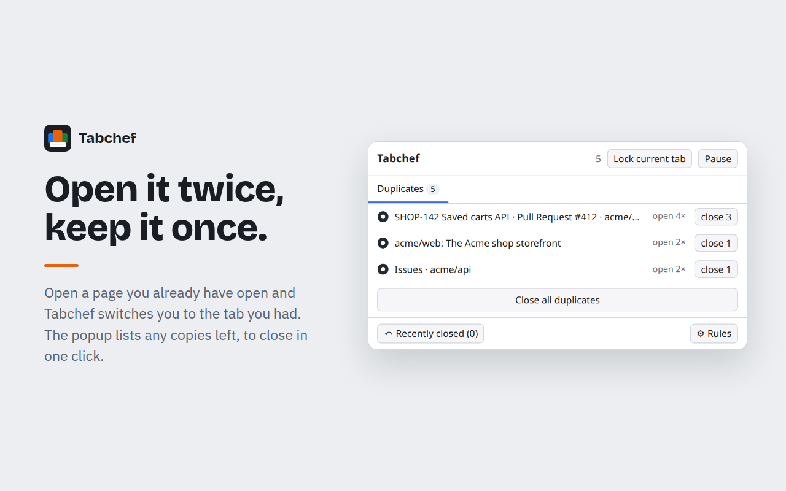
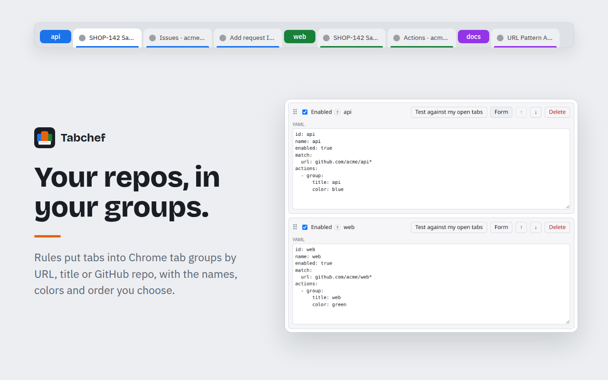
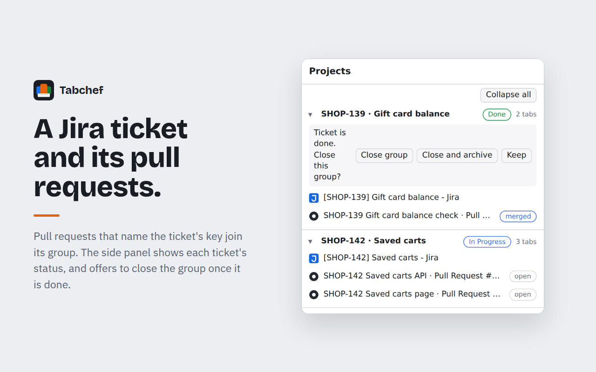
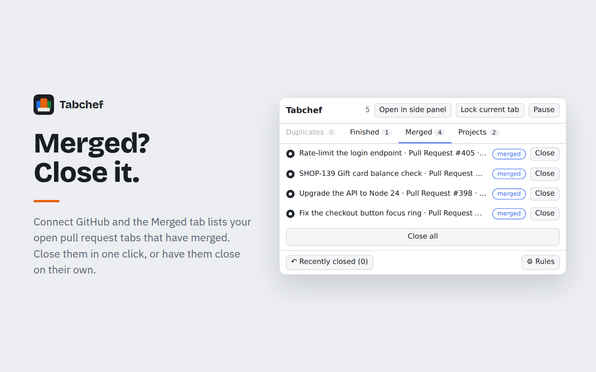
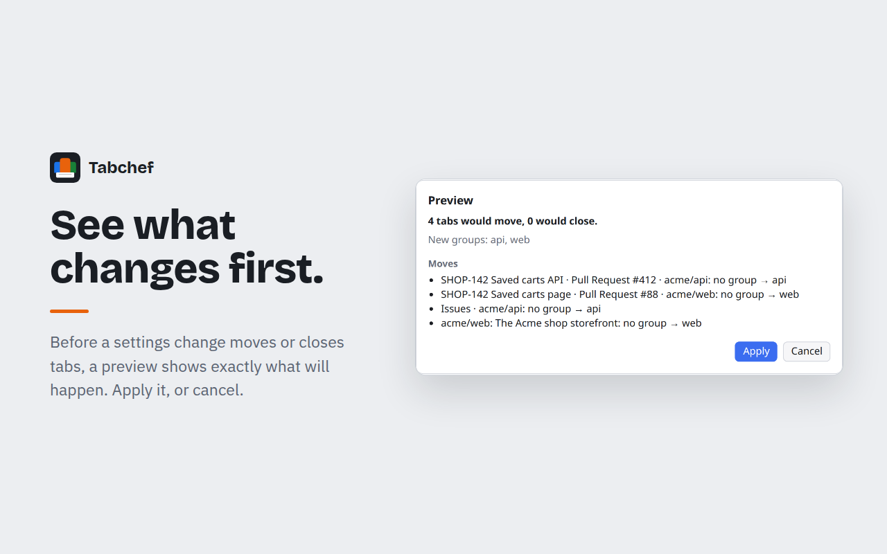

# Tabchef

Recipes for your tabs: a Chrome extension that groups, de-duplicates and closes tabs with rules you can read and change.



## Install

Coming soon to the Chrome Web Store. Until then, download `tabchef-<version>-chrome.zip` from the
[latest release](https://github.com/ecoutu/tabchef/releases/latest), unzip it, and load the folder with **Load unpacked**
on `chrome://extensions` (Developer mode on).

## What it does

- **Group** tabs into Chrome tab groups by URL, title or GitHub repo, with the names, colors and order you choose.
- **De-duplicate:** opening a page you already have open switches you to the existing tab. A pull request's Files,
  Commits and Checks pages count as the pull request itself.
- **Close finished tabs** (the Finished recipe): OAuth callback pages, redirect pages you list, and Google Meet tabs
  after the call ends. Pinned and locked tabs are never closed, and a tab with unsaved form edits is never closed
  without asking.
- **Recipes** bundle rules you turn on with one switch: Duplicates, Finished, GitHub pull requests, Merged PRs, the
  Jira ticket projects and Manual projects (a named project you add tabs to by hand). Recipe rules are read-only;
  Customize copies one into your own rules.
- **Your own rules** are edited in a form or as YAML, ordered by priority, and can be kept in named sections that
  collapse and move as one block.
- **Connections** to GitHub (device flow or a personal access token) and Jira (scoped or classic API token, or the
  browser's Jira session) let recipes read pull request and ticket status:
  - **Merged PRs** lists tabs of pull requests that have merged, and can close them.
  - **Jira ticket projects** group a ticket's tab with the pull requests that name its key in their title or branch.
    The popup's Projects tab and the side panel show each ticket with its status.
- **See what changes and why:** a preview before a change moves or closes tabs, a History of what happened and which
  rule did it, and "Why is this tab here?" for any open tab.

<details>
<summary>More screenshots</summary>






</details>

To change what a recipe does or write rules of your own, see the [guide to recipes and rules](docs/recipes.md).

## Privacy

Rules and tab data stay in your browser; settings sync through your Chrome account. Tabchef has no servers and no
analytics. With GitHub or Jira connected, Tabchef asks those services directly from your browser for the state of the
pull requests and tickets in your open tabs. Tokens are stored only in this browser and never synced or exported.
The full policy is in [PRIVACY.md](PRIVACY.md).

## Development

Requires Node.js 24 and Chrome or Chromium 116 or newer.

```sh
npm ci
npm run dev        # Chromium with the extension loaded and hot reload
npm run build      # production build in .output/chrome-mv3 (load it unpacked from chrome://extensions)
npm run zip        # the store zip
```

Checks (CI runs all of them):

```sh
npm run lint
npm run check            # svelte-check and tsc
npm test                 # Vitest unit and component tests
npm run e2e              # Playwright end-to-end tests against the built extension
npm run e2e:m3           # end-to-end tests of the GitHub and Jira flows against local mock services
npm run check:secrets    # the build holds no tokens and no test-only localhost access
npm run check:csp        # no eval or new Function in the build
npm run check:cycles     # no import cycles across the source layers
npm run check:terms      # the store listing, the guides and the UI use the same words
npm run validate:recipes # the built-in recipes match the recipe schema
```

The Chrome Web Store listing, the launch copy and the step-by-step submission guide are in [docs/store/](docs/store/).
The Tabchef GitHub App's listing, permissions and settings are in [docs/store/github-app.md](docs/store/github-app.md).

The extension icon's source is `docs/store/icon.svg`; after editing it, run `npm run icons` to render
`public/icon/{16,32,48,96,128}.png` (the 128 px one, also the store icon, keeps 16 px of transparent padding) and
`docs/store/icon-512.png`, the GitHub App's logo.

After changing `src/core/config/config.schema.json` or `src/core/lang/*.schema.json`, regenerate the validators with
`npm run gen:validator`.

### Store assets

```sh
npm run store:assets     # the Web Store screenshots and promo tiles, into docs/store/images/
```

It builds the e2e flavor of the extension into a temp dir (never `.output`, so `npm run zip` is unaffected), loads it
in Playwright's Chromium with demo tabs and the `e2e:m3` mock GitHub and Jira services, captures the real popup, options
page and side panel, and lays them out as the five captioned 1280×800 screenshots and the 440×280 and 1400×560 tiles
listed in `docs/store/listing.md`. No network is used and no real account is involved. The pieces live in `store/`:

- `brand.ts`: the product name (from `docs/store/terms.json`, which must match the manifest name), the tagline (the
  listing's Tagline section) and the icon (`ICON_SVG`, the extension icon's source `docs/store/icon.svg`). A rename or a
  new icon re-renders every image.
- `captions.json`: every word the images add; `npm run check:terms` checks it like the listing.
- `demo.ts`: the demo repositories, pull requests, Jira tickets and tabs.
- `fonts/`: Bricolage Grotesque, IBM Plex Sans and IBM Plex Mono (SIL Open Font License, `OFL-*.txt`), embedded in the
  images.

`--keep-captures` (`npm run store:assets -- --keep-captures`) also writes the raw captures. The images are committed:
after a UI, name or icon change, run the command again and commit the result.

## Release

Merging to `main` releases. semantic-release picks the version from the commits, updates `CHANGELOG.md`, tags the
release and attaches `tabchef-<version>-chrome.zip` to a GitHub release. Then `scripts/submit-stores.sh` uploads the
zip to the Chrome Web Store and submits it for review.

The store step is keyless: the release job's GitHub token is exchanged through Workload Identity Federation for a
one-hour Chrome Web Store access token as the `cws-publisher` service account. The workload identity pool admits only
this repository's `main`. No service account key exists. Until it is configured the step skips, and the release is on
GitHub only. To set it up:

1. Submit the first version by hand (`docs/store/submitting.md`).
2. In a Google Cloud project (`tabchef`), enable the Chrome Web Store and IAM Credentials APIs, create the
   `cws-publisher` service account with no project roles, and create a workload identity pool (`github`) whose GitHub
   OIDC provider admits only `assertion.repository == 'ecoutu/tabchef' && assertion.ref == 'refs/heads/main'`. Grant
   the pool's `attribute.repository/ecoutu/tabchef` principal set `roles/iam.workloadIdentityUser` on the service
   account.
3. In the Developer Dashboard, add `cws-publisher`'s email under **Account → Service accounts**.
4. Add four repository **variables** (Settings → Secrets and variables → Actions → Variables; none is secret):

   | Variable | Value |
   |---|---|
   | `CHROME_EXTENSION_ID` | the item ID, from the item's dashboard URL |
   | `CHROME_PUBLISHER_ID` | the publisher ID, from the dashboard URL after `devconsole/` |
   | `CHROME_SERVICE_ACCOUNT` | `cws-publisher@tabchef.iam.gserviceaccount.com` |
   | `CHROME_WIF_PROVIDER` | `projects/159741528756/locations/global/workloadIdentityPools/github/providers/github-oidc` |

5. Run the **Validate store credentials** workflow from `main` (Actions tab). It builds the zip and checks the
   credentials against the store with `--dry-run`, without uploading anything.

## Contributing

Bug reports, recipe ideas and pull requests are welcome: see [CONTRIBUTING.md](CONTRIBUTING.md).

Commits follow [Conventional Commits](https://www.conventionalcommits.org/); a commit hook runs commitlint, and
semantic-release builds the version and `CHANGELOG.md` from the commits on `main`. History stays linear: rebase, never
merge. Comments cite design decisions by short ids (for example `R19`, `M3-R57`); the surrounding text says what each
one decided.

## License

[MIT](LICENSE)
